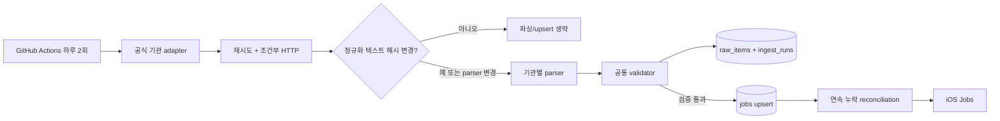

# 채용 데이터 수집 파이프라인

## 현재 상태

2026-10-02 기준 운영 파이프라인을 구현하고 원격 Supabase에 적용했다. 공식 기관
페이지의 영문·독문 공고를 수집하고, 공통 검증을 통과한 항목만 공개한다. 현재
활성 데이터는 다음 15건이다.

| 공식 소스 | 언어 | 활성 공고 |
|---|---:|---:|
| Münchner Philharmoniker | de | 8 |
| Oper Frankfurt | de | 2 |
| Karajan-Akademie der Berliner Philharmoniker | en | 5 |

공식 소스에 연결되지 않은 기존 demo curated 행은 `archived`로 전환했다. 테스트
계정의 실제 인증 토큰으로 프로필 1건과 `published` 공고 15건이 조회되는 것을
확인했다.

## 데이터 흐름



1. [`import_curated_jobs.py`](../scripts/import_curated_jobs.py)는 timeout, 일시적 HTTP
   오류 재시도와 지수 백오프, ETag/Last-Modified를 처리한다.
2. 광고·세션 토큰처럼 매 요청마다 변하는 HTML 때문에 재수집하지 않도록, 태그를
   제거하고 사용자가 보는 정규화 텍스트의 SHA-256을 비교한다.
3. 콘텐츠와 parser version이 모두 같으면 파싱과 `jobs` upsert를 생략한다. 마지막
   성공 run의 stable key만 재사용해 누락 확인은 계속한다.
4. parser version이 바뀌면 콘텐츠가 같아도 다시 파싱한다. 파서 수정이 기존
   content hash에 막히지 않는다.
5. 제목, 기관, 도시, 악기, 설명, 원문 URL, 언어, 날짜를 검증한다. 마감된 항목과
   필수 필드가 없는 항목은 게시하지 않는다. 갑작스러운 대량 감소와 설명 없는
   0건 결과는 실패 처리해 기존 공개 데이터를 보존한다.
6. 검증된 행은 `(source_id, external_key)`로 한 번에 upsert한다. nullable 필드도
   동일한 batch shape로 전송해 PostgREST bulk 요청을 안정적으로 유지한다.
7. 성공한 수집에서 3회 연속 사라진 행만 닫는다. 실패 run은 누락 횟수에 포함하지
   않는다.

## 스키마

[`0035_opportunity_ingestion_pipeline.sql`](../supabase/migrations/0035_opportunity_ingestion_pipeline.sql)이
다음을 추가한다.

- `opportunity_sources`: URL, 언어, parser, ETag, 의미 기반 content hash, 최종 성공
  시각과 연속 실패 수
- `opportunity_ingest_runs`: HTTP 상태, parser version, 발견·추가·수정·종료·경고
  건수와 오류
- `opportunity_raw_items`: run마다 검증된 정규화 payload와 item hash
- `jobs.source_id`, `external_key`, `source_content_hash`, `first_seen_at`,
  `last_seen_at`, `missing_runs`, `application_url`, `fee_currency`, `quality_score`
- city 변경 시 `jobs.zone`을 맞추는 trigger와 프로필 도시 변경 시
  `user_base_city`를 맞추는 trigger
- published curated 행만 일반 목록과 검색에 노출하는 RLS/RPC 조건

[`0038_curated_jobs_without_user_owner.sql`](../supabase/migrations/0038_curated_jobs_without_user_owner.sql)은
수집 공고가 사람 프로필을 가짜 게시자로 사용하지 않게 한다. 사용자 작성 공고는
계속 `user_id`가 필수이고 curated 행만 nullable owner를 허용한다.

[`0039_archive_unmanaged_curated_jobs.sql`](../supabase/migrations/0039_archive_unmanaged_curated_jobs.sql)은
공식 adapter로 재현할 수 없는 기존 demo curated 행을 보관 처리한다.

## 공개와 앱 표시

- curated 기본 review 상태는 `needs_review`다. validator가 통과시킨 행만
  `published`로 쓴다.
- `search_opportunities`와 jobs RLS 모두 user 공고 또는 published curated 공고만
  반환한다.
- 앱은 `source_url`, `application_url`, 원문 언어, 최종 확인 시각, quality score를
  decode한다.
- 상세 화면에는 공식 원문과 공식 페이지 지원 CTA가 표시된다. 수집 공고에는 사람
  게시자 영역과 소유자용 마감 버튼을 표시하지 않는다.

## 자동 실행

[`import-curated-jobs.yml`](../.github/workflows/import-curated-jobs.yml)은 매일 UTC
03:17, 15:17에 parser 테스트를 실행한 뒤 수집기를 실행한다. 저장소에는 관리자
키를 두지 않으며 GitHub Actions의 `SUPABASE_SERVICE_KEY` secret만 사용한다.

수동 확인과 적용 명령은 다음과 같다.

```bash
python3 scripts/import_curated_jobs.py --json
SUPABASE_SERVICE_KEY=... python3 scripts/import_curated_jobs.py --apply
```

특정 소스만 확인하려면 `--source <slug>`를 반복해서 사용할 수 있다.

## 검증 결과

- Python parser/validation 테스트 7개 통과
- 실제 공식 페이지 dry-run 통과
- 원격 migration 0035~0039 적용 완료
- 같은 콘텐츠 재실행 시 세 소스 모두 `unchanged`로 처리
- 테스트 계정 인증 상태에서 프로필 정상 조회, 활성 curated 15건 모두 published
- iPhone 17 / iOS 26.3 Simulator Debug 빌드·설치·실행 완료

## 남은 운영 작업

1. 과거 저장소에 노출됐던 `service_role` 키를 Supabase Dashboard에서 회전한다.
   코드에서는 제거했지만 이미 노출된 키 자체는 폐기해야 한다.
2. GitHub repository secret에 회전한 `SUPABASE_SERVICE_KEY`를 등록해야 schedule이
   실제로 실행된다.
3. 목록과 검색의 서버 필터·cursor pagination을 통합한다. 현재 앱 목록은 최대
   80개, 검색 RPC는 최대 50개다.
4. 공식 API/RSS/JSON-LD를 제공하는 기관부터 adapter를 늘리고, PDF와 JavaScript
   전용 페이지는 별도 adapter로 격리한다.
